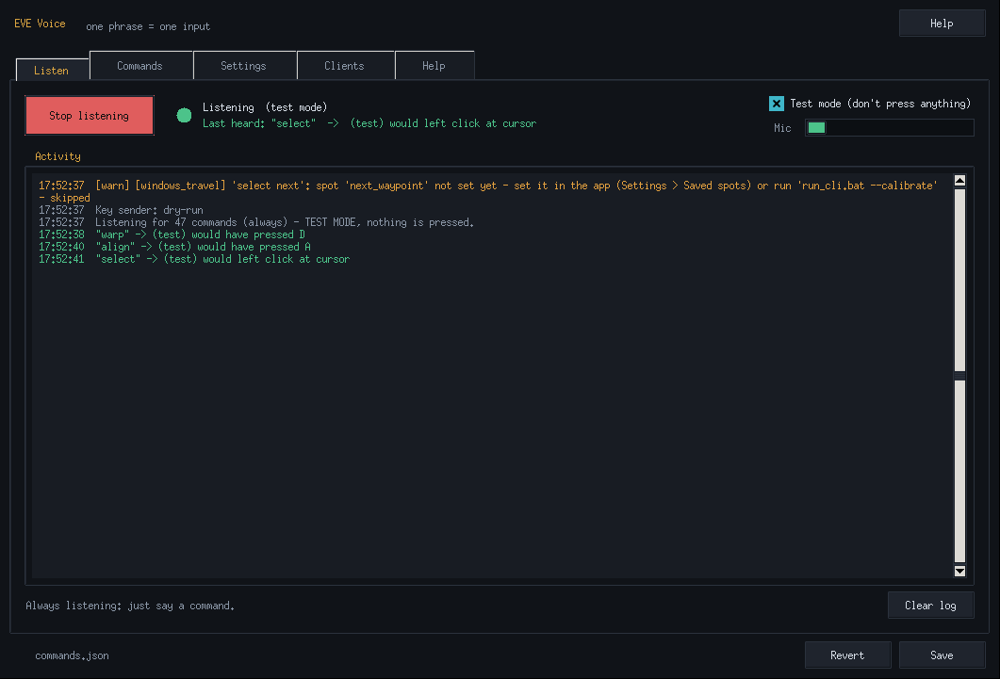
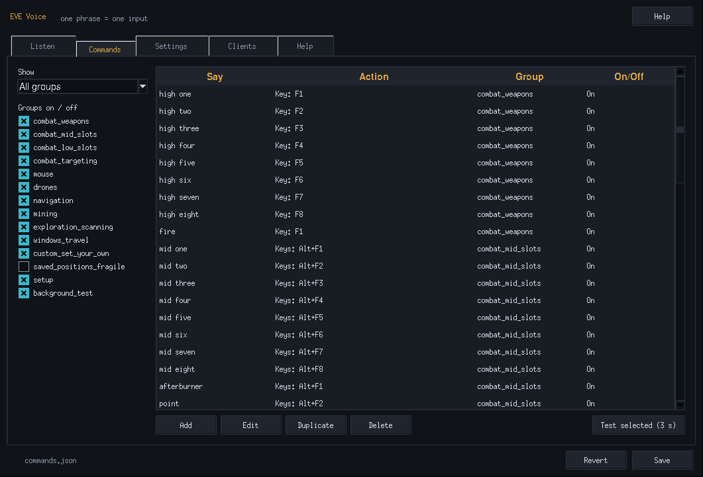
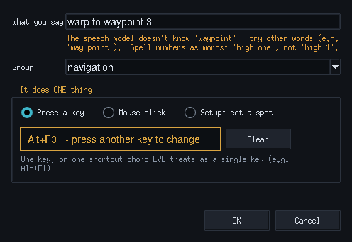

# EVE Voice

Say a word or phrase, and EVE Voice sends **one** key press or **one** mouse click to EVE Online.
It runs completely offline. Speech recognition is Vosk, so there are no accounts, API keys or cloud services.

## No Python? Just run setup.bat
1. **Unzip** this folder somewhere, e.g. `C:\eve-voice` (don't run it from inside the zip).
2. Double-click **`setup.bat`**. It finds Python 3.9+ or, if you don't have it, installs Python 3.12 for your user account (via winget, or the official python.org installer as a backup; no admin needed). Then it sets up a private environment, installs the libraries, downloads the offline speech model and puts an **EVE Voice** shortcut on your desktop.
3. Double-click **`run.bat`** (or the desktop shortcut). The EVE Voice window opens - no console.

The first setup needs an internet connection: about 25 MB for Python (only if you don't have it) and about 40 MB for the speech model. After that everything runs offline. If automatic install fails, setup.bat tells you what to do: install Python 3.12 from https://www.python.org/downloads/, **tick "Add python.exe to PATH"**, then run setup.bat again. Already have Python? setup.bat just uses it (keep "tcl/tk" ticked; the app window needs tkinter).

## Using the app


**Listen tab** - the big **Start listening** button, a status light (Listening / Stopped / Waiting for wake word / Hold *key* to talk), the last thing it heard (`Last heard: "warp" -> pressed D`) and a live activity log.
Tick **Test mode** to try everything safely: it listens and logs what it *would* press, but presses nothing.

**Commands tab** - every command in a table (Say | Action | Group | On/Off). Filter by group, switch whole groups on/off.
- **Add / Edit** (or double-click a row) opens the editor: type what you'll say, then choose **Press a key** (click the box and press the key or shortcut, e.g. Alt+F1), **Mouse click** (left/right/middle, at the cursor or at a saved spot) or **Setup: set a spot**.
  It warns you live if the speech model doesn't know a word, and reminds you to spell numbers ("high one").
  It can only ever make one-action commands: no combos, double clicks or Ctrl+click.
- **Duplicate / Delete**, and **Test selected (3 s)**: after a 3-second countdown (click into EVE) it fires that one command once. In Test mode it only logs.

 

**Settings tab** - microphone (with **Test mic** level bar), how it listens (always / push-to-talk with a key you press to record / wake word + how long it listens after it), spoken confirmation, log confirmation, "only send when EVE is the active window", repeat cooldown, key hold time, and **Saved spots** (Set... opens the drag-a-box overlay; Clear; New spot...).
Changes apply straight away (the listener restarts itself).

**Clients tab** - which client gets the input. Leave it on **The active window** unless you read "Two clients on one PC" below.

**Help tab** - quick start, the rules, buttons to open this README and the log.

**Save / Revert** (bottom right). Nothing is written until you press Save; it keeps all `_note` comments and writes `commands.json.bak` first. Closing with unsaved changes asks first. The window remembers its size and position.
If anything goes wrong you get a plain-English message, and the details go to `eve_voice.log`.

Run as administrator (right-click run.bat) if EVE ignores the keys.

## Rules / EULA compliance
EVE Voice follows three rules. The code enforces each one, and a test suite (`tests/`, the `TestCompliance` class) checks them.

**1. One input per word or phrase. No macros.**
Multi-word phrases like "keep at range" or "select next" are fine. Each word or phrase triggers exactly **one** keyboard action **or** one mouse click, never both, and never a chain.
- The config loader **rejects** entries that would break this, with a warning citing the 1:1 rule:
  - `"steps"` combos
  - an entry with both `key` and `mouse`
  - double clicks (that's two clicks)
  - modifier+click like Ctrl+click (that mixes keyboard and mouse)
- In the program there is exactly one place that sends input (`VoiceApp._send_one`). It makes one call per command, with no loop. The app window is only a front end for it; the editor can only create one-action commands.
- A click on a saved spot is **one click at a location** (`pydirectinput.click(x, y)`). The pointer goes there as part of that click, like clicking it by hand, and is **not** moved back afterwards.
- **Hotkey chords** that EVE treats as one shortcut (e.g. `alt+f1`, `ctrl+space`) count as **one** keyboard action: you'd press them together as one shortcut by hand. If you want to be ultra-strict, rebind those actions to single keys in EVE (Esc → Shortcuts) and put the single keys in `commands.json`.

**2. Pure input emulator.**
It listens to your microphone and sends OS-level key and mouse input to the **active window**.
- No memory reading, no injection, no hooks into the game, no log-file or screen scraping.
- The only Windows calls it makes are:
  - reading the foreground window title
  - reading the cursor position and screen size (for calibration)
  - checking whether your push-to-talk key is held (`GetAsyncKeyState`, a simple poll, not a keyboard hook)
  - only in the experimental background mode: listing windows and posting one key or click message to one of them
- The only files it reads or writes are its own: `commands.json` (+ `commands.json.bak` on save), `gui_state.json` (window size) and `eve_voice.log` (its own error log). It never reads EVE's files or logs.
- Input is only sent when the foreground window title contains "EVE" (`require_eve_focus`, on by default).
- The one exception is the **experimental, off-by-default** "background target" mode below. It's still one input to one client, but **not** "active window only".

**3. No timed delays to build combos.**
There are no `sleep`s between inputs because there's never a second input.
- `key_hold_seconds` is how long **one** key is held down (key down → key up). It's part of that single press, not a gap between actions.
- `cooldown_seconds` only **drops** an accidental repeat of the same phrase. It never adds input.

Using this tool within CCP's EULA is still your responsibility.

## Command-line version (advanced)
`run_cli.bat` runs the same engine in a console window, with no app window. Everything the app does uses this same engine, so the rules are identical.
- `run_cli.bat --list-devices` lists microphones.
- `run_cli.bat --dry-run` recognises speech but only prints what it *would* send.
- `run_cli.bat --text --dry-run` lets you type phrases instead of speaking (tests your config without a mic).
- `run_cli.bat --calibrate` sets a click spot by dragging a box (see below).
- `run_cli.bat --where` shows the mouse position every second (manual fallback).
- `run_cli.bat --list-windows` / `run_cli.bat --test-background` are for the experimental two-client mode (see below).
- `run_cli.bat --config other.json` uses a different config file (e.g. one per client).
- `run_cli.bat --verbose` shows speech-engine messages, including any phrase word the model doesn't know.
- `run.bat --demo` opens the app with a fake microphone (to try the window without a mic).

## Trigger modes
Set `"mode"` in `settings`:

| mode | How it works | Good for |
|---|---|---|
| `"always"` (default) | Every recognised phrase fires. | Solo play, quiet room. |
| `"push_to_talk"` | Only listens while you hold `push_to_talk_key` (default `scroll lock`). Speak, then release. | Voice comms, noisy rooms. Fewest false triggers. |
| `"wake_word"` | Say the wake word first: **"computer warp"**, or **"computer"**, pause, then **"warp"** within `wake_window_seconds` (default 4). One command per wake. | Hands-free while you also talk on comms. |

## Default commands (one input each)
| Say | Does |
|---|---|
| select / click | left click at the cursor |
| right click / middle click | right / middle click at the cursor |
| select next | left click on the saved **next waypoint** spot (set it once, see below) |
| warp | **hold D until you click** (your spec: D) |
| align / approach / orbit / keep at range | **hold** A / Q / W / E **until you click** |
| lock / lock target | **hold Ctrl until you click** |
| release / let go | let go of the held key right away |
| gate (also: select next gate, next gate, select gate) | ONE left click on the yellow next gate in your Overview (**opt-in, off by default**, see below) |
| teach command | opens Teach (sends nothing) |
| stop ship | Ctrl+Space |
| high one … high eight, fire | F1 … F8, F1 |
| mid one … mid eight, afterburner, point, web | Alt+F1 … Alt+F8, Alt+F1, Alt+F2, Alt+F3 |
| low one … low four, repair | Ctrl+F1 … Ctrl+F4, Ctrl+F1 |
| launch drones / drones attack / drones return | Shift+F / F / Shift+R |
| lasers / second laser / survey scan | F1 / F2 / Alt+F4 |
| scan / d scan window / probe scanner | V / Alt+D / Alt+P |
| map | F10 |
| test background | F10 (harmless check for the experimental two-client mode) |
| set way point spot | setup only: opens the calibration overlay (sends nothing to EVE) |

**Empty until you bind them** (put your key in `commands.json`):
- **dock / jump:** D is used for warp here.
- **Also empty:** next/previous overview tab, toggle autopilot, open cargo, unlock target.

⚠️ **Check the keybinds.** Your spec maps **warp → D**, but EVE's own default is **S = Warp To** and **D = Jump/Dock**. Check everything in Esc → Shortcuts and make `commands.json` match. Movement keys act on the item **selected** in EVE, so say "select" (cursor over it) or "select next" first, then "warp" as a separate command.

## Hold-and-click (lock, approach, orbit, warp ...)
EVE's default actions are **hold a key, then click the target**: Ctrl = lock, Q = approach, W = orbit, E = keep at range, A = align, S = warp to, D = jump/dock. A quick tap of those keys does nothing, which is why it felt "wonky" before.

So these commands now **hold the key until you click**: say "lock", the app presses Ctrl **down** (one input), **you** click the target in space or in the Overview, and the app lets Ctrl **up** right after your click is released. The app never clicks in this mode. It checks the left mouse button with a simple `GetAsyncKeyState` poll every 10 ms (the same kind of read push-to-talk uses). No mouse or keyboard hook is installed.

Each command can be set in **Edit → When said**:
- **Tap the key.** Use this when something is already selected and EVE acts on a plain key press (Selected Item panel keys).
- **Hold this key for N seconds** (0.1–10 s). The tap length cap (0.5 s) only applies to taps.
- **Hold until I click.** Safety limit 10 s by default, 30 s max.
- **Hold until I say 'release'.** Safety limit 30 s.

In `commands.json`: `{"key": "ctrl", "hold_until": "click"}`, `{"key": "q", "hold_seconds": 3}`, `{"key": "q", "hold_until": "release", "hold_max": 20}`.

**Still one input per phrase.** A hold is one key-down and, later, the matching key-up of the same key. Only one key is held at a time. If you start a new hold, or the app sends any other **key**, the held key is let go **first** (so a tap never becomes a chord). A **click command** (e.g. "gate", "click", "select") is different since 1.0.1: the held key stays down while that ONE click is sent, because that's exactly EVE's hold-key-then-click. You said two commands ("warp", then "gate"), the app sent two inputs (D down, one click), and nothing is added in between. In hold-until-click mode the key is let go right after that click; a timed hold keeps running until its time is up.

**The key is always let go:**
- after your click
- when the timer or safety limit runs out
- when you say **"release"** or **"let go"**, or press the **Release** button on the Listen tab (it shows "Holding Ctrl - click your target (4.2s)")
- when EVE loses focus
- on Stop or a settings or mode change
- when the app closes or crashes (atexit plus try/finally)

Background-window mode supports timed and 'release' holds of single keys (WM_KEYDOWN now, WM_KEYUP later). Hold-until-click is skipped there because your click can't reach a background window.

⚠️ Per your spec **warp = D**, but EVE's default **Warp To is S** (D is Jump/Dock). If warp does nothing, change `warp` to `s` (or rebind in Esc → Shortcuts).

**With "gate":** say **"warp gate"**, in one breath or with a pause. "warp" holds D, "gate" clicks the yellow gate once while D is down, then D is let go. Said in one breath, the app splits it into the two commands, in the order you said them.

## "Gate" (opt-in, reads the Overview pixels)
**Off by default.** When on, and only when you say the phrase, the app takes ONE picture of your Overview box with Pillow. It finds the yellow next-on-route gate icon (HSV hue ±10° around the colour you pick, saturation ≥ 0.45, icon-shaped), then sends ONE left click on it. It never watches continuously and reads no game memory or files. It saves nothing unless you press "Show what it sees". If it finds no yellow gate, or two yellow rows far apart, it clicks nothing and logs why. Normal grey gates are never matched.

This is a **gray area** under the EVE EULA. If you want to be sure, ask CCP support before using it.

**Setup** (Next gate tab):
1. **Set Overview area:** drag over the Overview rows.
2. **Pick the yellow colour:** click once on the yellow icon while you have a route set.
3. Tick **Turn on**. It refuses until steps 1–2 are done.

"Show what it sees" saves `what_it_sees.png` with the chosen row marked. Measured from your icon screenshot: yellow outline RGB (224,238,64), hue ≈ 65°, saturation ≈ 0.7. The grey gate has saturation ≤ 0.01.

## Recognition settings (Settings → Recognition)
- **How sure before acting:** default 55%. Below this it logs `heard 'warp' (48%) - not sure, skipped` and sends nothing.
- **Noise gate:** default 0.04, the red line on the level bar. "Measure noise" sets it to your background level + 0.02.
- **Act after you stop talking:** 0.35 s.
- **Fast response (act on partial results):** on by default. A command fires as soon as it's fully heard, without waiting for the end of the sentence, unless a longer command could still be coming ("lock" waits to see if it's "lock target"). Several commands in one breath ("warp gate") fire one by one in spoken order; each is still one input, and the final result never fires one twice. (Not used in wake-word mode.)
- **Show things it heard that weren't commands**, with the closest command.
- **Also accept:** other ways to say a command, set per command. They all do the same one action.

Defaults come from your test recording. All 4 "warp"s were recognised at 100% in command mode with no false triggers, and in the background noise the peak level was 0.01–0.03.

**Speech accuracy:** Fast (the small model) or Accurate (the larger `vosk-model-en-us-0.22-lgraph`, ~128 MB download, offline afterwards). Accurate is recommended because it is more confident with free speech and noise.

**Practice** (Commands tab): say commands and see what was heard and how sure it was. It flags phrases that are unreliable or that get mixed up with each other, and suggests other ways to say them. Nothing is sent.

**Teach** (Listen tab button or "teach command"):
1. Say the phrase (or type it).
2. Press ONE key/chord or click ONE spot on the see-through overlay. This needs windowed or fixed-window EVE.
3. Confirm and Save.

Teach stores one input, never a sequence.

## "Select next" (one-time setup)
1. Put EVE in **windowed or fixed-window mode** (an overlay can't draw over exclusive fullscreen). Make the next waypoint visible, e.g. the top row of an Overview tab sorted for it, or the route panel.
2. In the app: **Settings → Saved spots → next_waypoint → Set...** (command line: `run_cli.bat --calibrate`).
3. The app window hides and a see-through layer covers the screen (command line: press Enter, click into EVE, wait 3 seconds).
4. **Drag a box over the spot** and let go. The centre of the box is what gets clicked. **Esc** (or right-click) cancels.

In-game you can say **"set way point spot"** to redo it. That phrase is two words because the speech model doesn't know "waypoint".

⚠️ **Saved spots are fragile.** Moving or resizing the EVE window, changing resolution or UI scale, or dragging panels makes the spot wrong. Just recalibrate. Until a spot is set, "select next" is skipped with a warning. Saving keeps all your comments and writes `commands.json.bak` first. Windows display scaling and multiple monitors are handled.

Advanced: a command can have its own box (`"mouse_box": [left, top, right, bottom]`, set with `--calibrate "phrase"`) or a hand-typed point from `--where` (`"mouse_at": [x, y]`). These need `"allow_mouse_at": true`, which calibrating turns on.

## Two clients on one PC (experimental)
**Off by default.** This lets you fly one EVE client by hand (in front) while voice controls a second client in the background.

**What it does:** with `"target": {"mode": "background_window", "window_title": "EVE - Character Name"}` in `commands.json`:
- Each phrase posts **one** key (key down + key up) or **one** click on a saved spot to the **one** window whose title matches *exactly* (upper/lower case ignored).
- It doesn't bring that window to the front and doesn't move your mouse.
- If **no** window or **more than one** window matches, it sends **nothing** and prints a warning. It can never send to two windows. This is *not* input broadcasting.
- Foreground input is switched off completely in this mode.

**Limits:**
- **Single keys only.** Chords like Alt+F1 or Ctrl+Space are skipped, because the background client would see your real Ctrl/Alt/Shift state, not ours. Rebind those actions to single keys if you need them.
- **No clicks at the cursor.** Your cursor is over your main client. Saved-spot clicks (like "select next") are sent with that client's coordinates.

**It may simply not work.** Games often read raw input and ignore posted window messages. Test it first:
1. `run_cli.bat --list-windows` lists every window with "EVE" in its title. Copy the exact title of the client you want to voice-control (EVE titles look like `EVE - Character Name`).
2. Put it in `target.window_title` (keep `mode` as `"foreground"` for now).
3. Run `run_cli.bat --test-background`, then within 3 seconds click into your *other* client. It sends one F10 (map). If the map toggles on the background client, it works. If not, this mode won't work for you.
4. Only then switch to background mode (app: Clients tab, or `"mode": "background_window"`). Saying "test background" does the same F10 test by voice.

**Rules note:** this is still one input per phrase to one client, with no chaining and no delays. It does **not** follow your spec's "inputs only to the active window" rule, and CCP's view on sending input to an unfocused client isn't clear. **Ask CCP support before relying on it.** The fully supported alternative: run the second client and this tool on a **second PC** in normal foreground mode.

**Running two copies of the tool (one per client):**
- Make a copy of the config, e.g. `commands-bravo.json`. Set its `target` to the second client and use a **different trigger** so your voice goes to the right copy:
  - wake words: `"mode": "wake_word"`, with `"wake_word": "alpha"` in one config and `"bravo"` in the other ("alpha warp" vs "bravo warp"), or
  - push-to-talk: different `push_to_talk_key`s.
- Start each copy in its own window: `run.bat --config commands-bravo.json` opens a second app window on that config (or `run_cli.bat --config ...` for consoles). The foreground copy keeps `"mode": "foreground"`; only the second one uses `background_window`.
- Both copies hear everything, so phrases without the right wake word are ignored by the other copy.

## Editing commands
The easiest way is the **Commands tab** in the app. You can also open `commands.json` in Notepad (close the app first). Commands are grouped by activity. **Delete groups or lines you don't use.** Fewer phrases means better accuracy.
- Left side: what you say. Use plain words, spell numbers out ("high one"), and pick phrases that don't sound alike.
- Right side: **one** of these:
  - a key: `"q"`, `"f1"`, `"space"`
  - a chord: `"ctrl+f1"`, `"shift+r"`
  - a single click: `{"mouse": "left"}`, `"right"` or `"middle"`
  - a single click on a saved spot: `{"mouse": "left", "mouse_spot": "next_waypoint"}`
- `""` means not set yet (skipped). `"enabled": false` turns a group off. Keys starting with `_` are comments.
- Restart after editing by hand. Changes made in the app apply by themselves.

## Updates
The app updates itself from GitHub Releases. Your version is shown in the title bar and on the Help tab.

- **On start** (Settings → Behaviour → "Update automatically on start", on by default) the launcher checks for a newer signed release, with a 5 second timeout. If one is ready it shows a small "Updating to X..." window, installs it, and then opens the app. If you're offline or GitHub is busy, it just starts normally.
- **Help → Check for updates** downloads and checks a new version in the background. When it's ready, a **Restart to update** button appears.
- **Every release is checked**: its Ed25519 signature must match the key built into the app, and the zip's SHA-256 hash and size must match. Older versions (downgrades), bad signatures and bad hashes are refused, and the reason goes in `update.log`.
- **Your files are never touched:** `commands.json` (+ `.bak`), `gui_state.json`, `eve_voice.log`, `model*/` folders, `venv/`, and your saved spots and teaches (they live in `commands.json`). New default commands from an update are *added* to your `commands.json` (listed in `update.log`). Your own values are never changed, and commands you deleted aren't added back. A copy from before the merge is kept as `commands.json.before-update`.
- **Safety net:** the old code is copied to `previous_version/`. If the new version fails to start, the next launch puts the old one back automatically and skips that version. If `requirements.txt` changed, the update runs `pip install -r requirements.txt` in your `venv` first.
- Settings in `commands.json`: `"auto_update"`, `"update_source": {"type": "github", "repo": "WeBeAscended/eve-voice"}` and `"update_url"` (a static folder holding `latest.json`, `latest.json.sig` and the zip). If the Releases API fails or is rate-limited, the app tries the `release/` folder of the repo's `main` branch (`https://raw.githubusercontent.com/WeBeAscended/eve-voice/main/release/`) instead. The same signature and hash checks apply.
- Upgrading from a build without auto-update: unzip the new installer over the old folder and run `setup.bat` once. It installs `cryptography` and points the shortcut at the launcher.

### Publishing a new build (developer)
Signing happens only on the publisher's machine. GitHub Actions publishes the release:
```
python tools/make_release.py --bump patch --notes "What changed"   # signs, writes release/ (+ version.py, app_manifest.json)
git add -A && git commit -m "Release 1.0.1" && git push origin main
```
`.github/workflows/release.yml` runs when a push to `main` changes `release/latest.json`. It reads the version from that file, creates the GitHub Release `v<version>`, and uploads `release/eve-voice-<version>.zip`, `release/latest.json` and `release/latest.json.sig` (skipped if the tag already exists). `make_release.py` also prints an equivalent `gh release create ...` command if you'd rather publish by hand.

The signing key is `/workspace/eve-voice-signing/private_key.pem` (or set `EVE_VOICE_SIGNING_KEY`). Keep it secret and backed up. Never commit it or put it in the app folder (`.gitignore` blocks `*.pem`/`*.key`). Without it, already-installed copies can't be updated.

## Why these libraries
- **Vosk:** offline, and uses a phrase-limited grammar for accuracy and speed. *SpeechRecognition* is an alternative but needs a backend (often an online API).
- **pydirectinput:** sends DirectInput-style scancodes that DirectX games like EVE register. *pyautogui* and *pynput* often aren't registered by DirectX games. *keyboard* and *pynput* stay as automatic fallbacks only.

## Troubleshooting
- **Nothing is recognised.** Pick your mic in Settings and press Test mic (or `run_cli.bat --list-devices`). Check Windows Settings → Privacy → Microphone → allow desktop apps.
- **A phrase never triggers.** The editor warns about unknown words; or run `run_cli.bat --verbose` and look for "Ignoring word missing in vocabulary". Reword that phrase.
- **"EVE window isn't focused".** The title must contain `window_title_contains` (default `"EVE"`).
- **setup.bat installed Python but then says it can't find it.** Close the window and double-click setup.bat again (a fresh window picks up the new PATH).
- **Keys or clicks don't register.** Settings → "Keys sometimes don't register?" raises the tap length to 0.08 s and tells you whether the app is running as administrator. If EVE or its launcher runs as admin, run `run.bat` as administrator too. For approach/orbit/lock and similar, use hold-until-click (see above): a tap does nothing in EVE.
- **"select next" clicks the wrong thing.** Your UI moved; recalibrate.
- **The overlay doesn't show over EVE.** Use windowed or fixed-window mode.
- **False triggers.** Use `push_to_talk` or `wake_word` mode and remove phrases you don't use.
- **The window doesn't open.** Look in `eve_voice.log`; run `venv\Scripts\python.exe eve_voice_gui.py` to see errors; or use `run_cli.bat`.
- **"Config problem: ... not valid JSON".** Fix the comma or quote at the reported line, or restore `commands.json.bak`.

## Files
`launcher.py` (starts the app, applies updates) · `autoupdater.py` + `eve_update.py` + `version.py` (updates) · `eve_voice_gui.py` (the app window) · `eve_voice.py` (the engine + command line) · `gate_finder.py` (opt-in next-gate finder) · `commands.default.json` (copied to your `commands.json` on first run) · `requirements.txt` · `setup.bat` · `run.bat` (app) · `run_cli.bat` (console) · `docs/` (screenshots) · `tests/` (run with `venv\Scripts\python -m unittest discover -s tests`)
